# NF1.UD4.-AA1-NFSa


Per començar, hem de crear dues màquines virtuals: Ubuntu Server 24.04 LTS, que farà de servidor, i Zorin OS 18, que farà de client. Cada màquina ha de tenir dues interfícies de xarxa: una de tipus **NAT** per accedir a Internet i una de tipus **Adaptador només amb l'amfitrió (Host-only)** per comunicar-se entre elles. Cal comprovar que totes dues tenen Internet i que es poden comunicar per la xarxa Host-only. Durant la instal·lació, seleccionarem l'espanyol (Espanya) com a idioma i instal·larem el servei SSH al servidor.


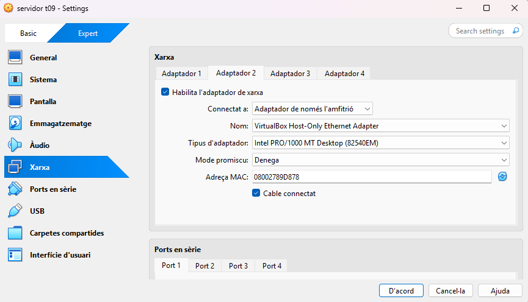

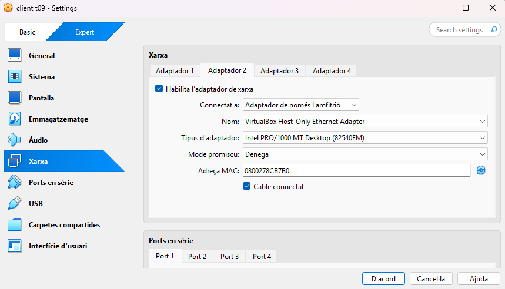


**---**

Un cop que ja tenim les dues maquines configurades començem configuran el servidor (ubuntu base)


La primera comanda que utilitzarem servira per actualitzar els paquets.


```bash

sudo apt update && sudo apt upgrade -y&#x20;

```


Cuan hem executat la comanda, hem de tornar a executarla per comprobar que no quedin actualitzacions.


**---**

Un cop que ja tenim actualitzat tots els paquets i ho haguem comprobat, el seguent pas sera començar amb la creació de l'estructura de carpetas, de grups i usuaris.


El primer que farem serà crear els dos grups que demana l'activitat: **devs** i **admins**. El propietari dels directoris serà root i cada grup tindrà accés al seu directori corresponent.


Per crear aquest grups farem la seguent comanda&#x20;


```bash

groupadd devs

```

I tambe la comanda:


```bash

groupadd admins

```

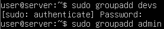


**---**

Per poder comprovar que els grups s'han creat correctament farem servir la comanda greep dev per buscar els 2 grups, el grup **devs** i el grup **admin**, hem d'entrar dins de l'arxiu /etc/groups, per fer-ho farem la seguent comanda:


```bash

grep devs /etc/group

```

I tambe la comanda:


```bash

grep admins /etc/group

```


En la qual com podrem veure en la captura, els 2 grups d'han creat correctament


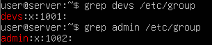


**---**

Un cop que ja tenim els grups creats el seguent pas sera crear l'usuari **dev01** que formi part del grup **devs**, per fer això farem servir la seguent comanda


```bash

useradd -G devs -m -s /bin/bash dev01

```


Per confirmar que esta creat l'usuari dev01 correctament fem servir el grep dev un alre cop pero ara hauriem de fer dev01 per localitzar especialment aquell usuari.


```bash

grep dev01 /etc/passwd

```


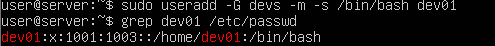


**---**

Un cop que ja tenim l'usuari dev01 el seguent pas sera crear el segon usuari que en aquest cas seria **admin01**, ha de formar part del grup **admin**, per fer això farem servir la seguent comanda


```bash

useradd -G admins -m -s /bin/bash admin01

```


Per confirmar que esta creat l'usuari **admin01** correctament fem servir la comanda grep com anteriorment pero hem de posar grep admin01 per localitzar el usuari admin i no dev.


```bash

grep admin01 /etc/passwd

```

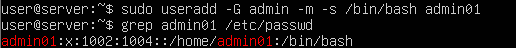


**---**

Un cop que ja hem creat els grups i els usuaris, el seguent pas es crear el directori per als projectes en la qual la ruta que ens demana és la seguent /srv/nfs/dev_projects, per crear les totes les carpetes sense haber de fer mes d'una comanda hauriem de possar mkdir per crear carpetes i -p per ferles totes.

```bash

mkdir /srv/nfs/dev_projects -p

```


**---**

Un cop fet això crearem el directori per a les eines d'administració en la qual la ruta sera /srv/nfs/admin_tools.


```bash

mkdir /srv/nfs/admin_tools

```


**---**

Per últim, configurarem les propietats dels directoris amb `chown`. El propietari serà `root` i el grup serà `devs` per als projectes i `admins` per a les eines d'administració.


```bash

chown root:devs /srv/nfs/dev_projects

```


```bash

chown root:admins /srv/nfs/admin_tools

```

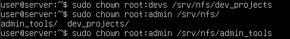


Un cop assignades les propietats, aplicarem `chmod 770` als dos directoris. Això dona permisos totals al propietari i al grup, i cap permís a la resta d'usuaris. Per tant, `dev01` ha de pertànyer a `devs` i `admin01` a `admins`.


```bash

chmod 770 /srv/nfs/dev_projects

```


```bash

chmod 770 /srv/nfs/admin_tools

```


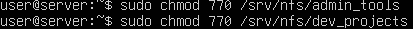


Per comprobar que els permisos s'han aplicat correctament hem de utilitzar la següent comanda per veure els permisos.


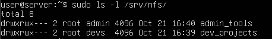


**---**

## Fase 2


Per poder continuar hem de crear els grups i usuaris dins de la maquina client (Zorin), per crear els grups i usuaris farem instalem la aplicació "users and groups". Hem de seguir els següents pasos tal com ho indico a les captures.


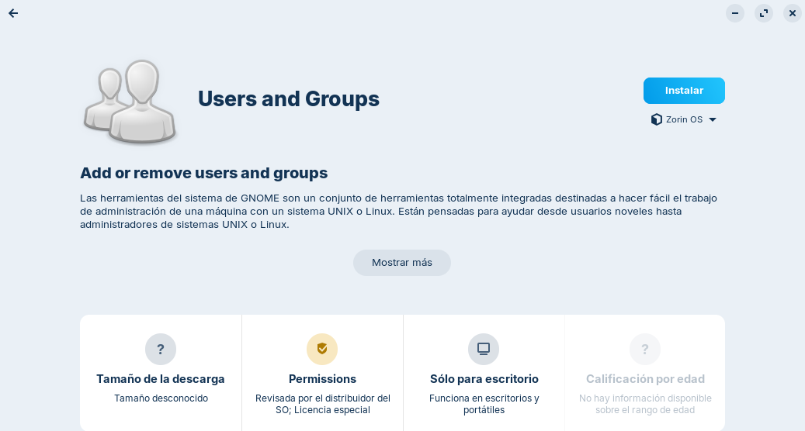


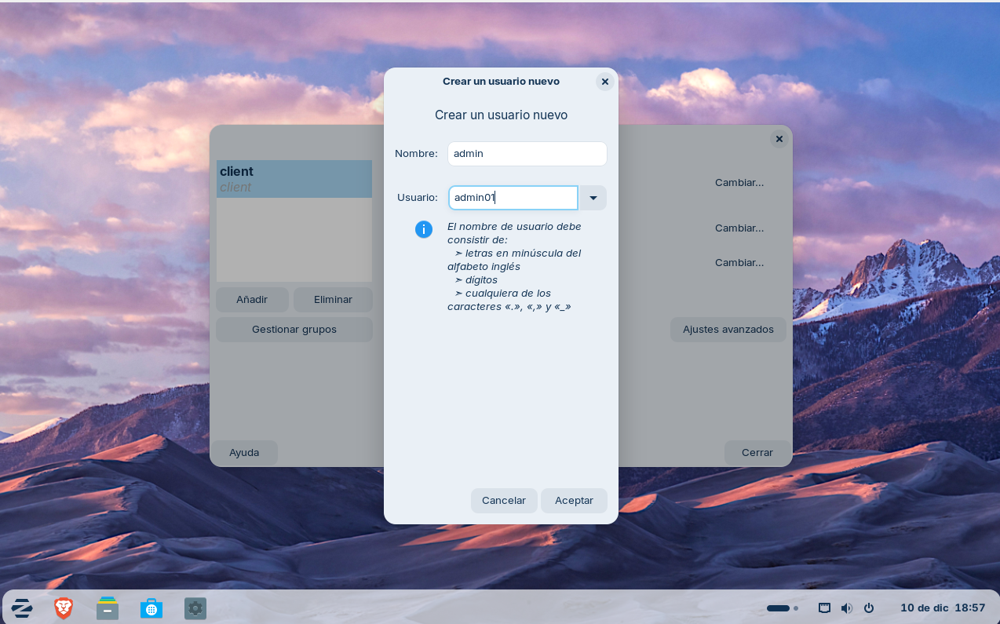


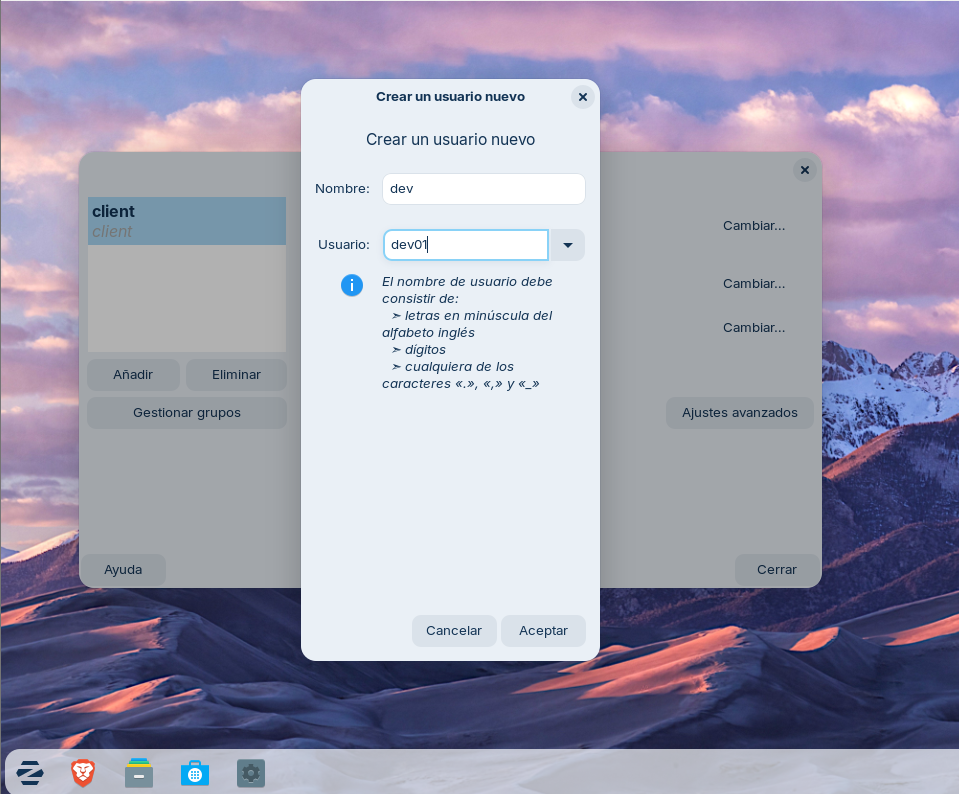


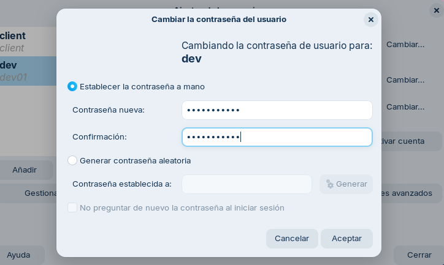


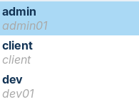


Hem de comprobar que els números d'identificació coincideixin a les dues màquines tal com surt en la captura.


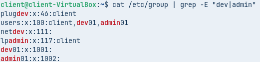

Els UID i GID dels usuaris i grups han de coincidir a les dues màquines. Si no coincideixen, cal ajustar-los abans de continuar; NFS utilitza aquests identificadors numèrics per comprovar la propietat i els permisos.


**---**

## Instal·lació i configuració del servei NFS


Ara instal·larem el servidor NFS amb la comanda: sudo apt install (i el nom de el servidor que volem instalar)


```bash

sudo apt install nfs-kernel-server -y

```


Veiem que s'ha instal·lat correctament i podem continuar, sino hem de tornar a fer la comanda i si surt error hauriem de comprobar si tenim wifi.


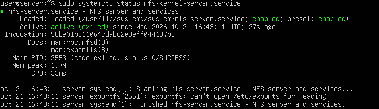


**---**

En aquest pas hem de configurar l'exportació dels directoris amb les opcions corresponents.


Per a fer-ho haurem de editar l'arxiu `/etc/exports`. Pero per poder editar-ho correctament hem d'utilitzar sudo nano, sino no deixara editar el archiu correctament.


```bash

sudo nano /etc/exports

```


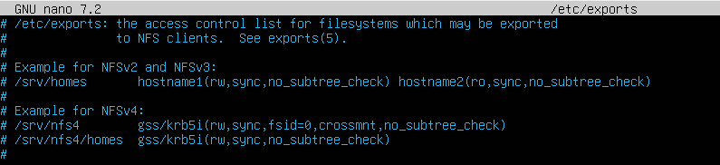


**---**

Per començar, aquesta exportació general permetrà consultar el recurs. Per a la prova 1 de la fase 3, però, cal que `/etc/exports` contingui una exportació específica per a `/srv/nfs/admin_tools` amb les opcions `rw,sync` i sense `no_root_squash`. Més endavant substituirem aquesta configuració per les exportacions específiques de cada prova. En un entorn real, convé limitar l’accés a les IP dels clients.


```bash

/srv/nfs *(rw,sync,no_subtree_check)

```


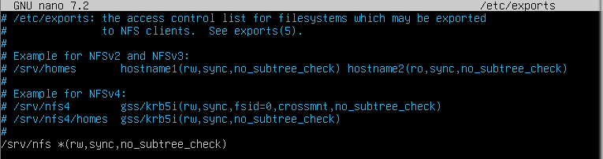


**---**

Ara hem d'aplicar el canvis, ho haurem de fer reinciant el servei amb la comanda sudo system restart (i el nom del servidor kernel). La comanda seria la següent:


```bash

sudo systemctl restart nfs-kernel-server

```

Cuan acabem reiniciant el servei hem d'iniciarlo i comprobar que tot esta correcta i funciona.


```bash

sudo exportfs -v

```

Amb aquesta comanda podem veure quins arxius es poden exportar. La captura et mostra que hauria de sortir.


**---**

Tambe podem fer la seguent comanda per veure en quin port treballa, en aquest cas ho fa amb el port 2049 que es el que inidica **NFS**.


```bash

rpcinfo -p 192.168.56.103

```

(Hem de possar la ip de la maquina que seria basicament la del servidor)


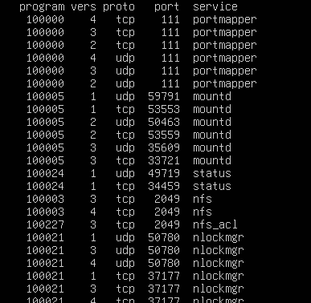


**---**

Per poder comprobar si hem fet be el anterior pas hem d'instalar el paquet nfs-common amb sudo apt install.

Ho hem de fer desde el cmd del client. Si ho fas desde el servidor no ho podrem comprobar correctament.


```bash

sudo apt install nfs-common -y

```


**---**

Cuan hem acabat de instalar nfs-common ens hem de conectar al servidor, ho hem de fer amb la comanda showmount -e (192.168.56.103) aquesta seria la meva comanda ja ques es la meva ip pero hauries de fer amb la teva ip.


```bash

showmount -e 192.168.56.103

```


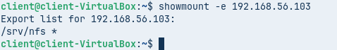


**---**


# Fase 3


En aquesta fase farem dues proves per entendre l’opció `root_squash`. Per a la prova 1, edita `/etc/exports` i utilitza aquesta exportació específica per al directori d’administració, sense `no_root_squash`:

```bash
/srv/nfs/admin_tools *(rw,sync,no_subtree_check)
```

Aplica els canvis amb `sudo exportfs -ra` i comprova les exportacions amb `sudo exportfs -v`.


Previament ja hem fet tots els pasos anterios hem exportat l'arxiu /srv/nfs, per tant el seguent pas que hem de fer sera montar el recurs a la carpeta /mnt/admin_tools, aquesta carpeta no existeix, per tant el primer pas es crear-la, ho farem amb la seguent comanda mkdir que s'utlitza per crear carpetas com he mencionat anteriorment i possar la ruta de la carpeta.


```bash

sudo mkdir -p /mnt/admin_tools

```


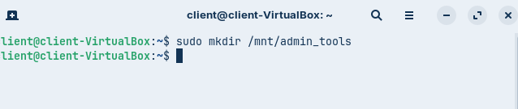


**---**

Cuan ja la tenim creada la carpeta /mnt/admin_tools, el seguent pas es montar el recurso, això ho hem de fer amb la comanda mount -t.


```bash

sudo mount -t nfs 192.168.56.103:/srv/nfs/admin_tools /mnt/admin_tools

```


En aquesta primera prova, el root del client no hauria de poder crear fitxers si els permisos del directori no li ho permeten. Amb NFS, l'opció predeterminada `root_squash` transforma les peticions de l'usuari root del client en un usuari sense privilegis (normalment `nobody`/`nfsnobody`) al servidor; per això el root del client no conserva automàticament els privilegis de root al servidor.


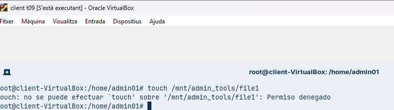


**---**

Si iniciem sessió com a `admin01`, i aquest usuari té el mateix UID/GID que al servidor i pertany al grup `admins`, hauria de poder escriure al directori segons els permisos locals. La captura següent mostra aquesta comprovació.


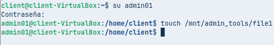


**---**

Podriem veure que l'arxiu que hem creat es de la propietat de admin01 com es veu a la captura.


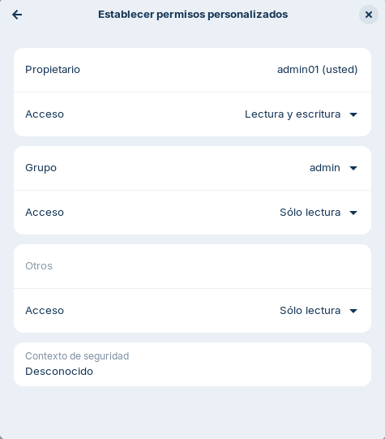


A continuació farem la segona prova que consisteix en poder crear arxius amb root.


**---**

Prova 2

**---**

Per a la segona prova, editarem `/etc/exports` i deixarem una exportació específica per a cada directori. A `admin_tools` afegirem `no_root_squash` només per demostrar-ne l'efecte; aquesta opció dona privilegis de root del client sobre els fitxers exportats i s'ha d'utilitzar amb molta precaució.


```bash

/srv/nfs/admin_tools *(rw,sync,no_subtree_check,no_root_squash)

/srv/nfs/dev_projects *(rw,sync,no_subtree_check)

```


**---**

Un cop possat les dos lineas i sustituit per la linea anterior hem de reiniciar el servei per poder aplicar els canvis com hem fet anteriorment.&#x20;


```bash

systemctl restart nfs-kernel-server

```


**---**

Ara haurem de desmontar i montar un altre cop el recurs, la meva comanda seria aquesta:&#x20;


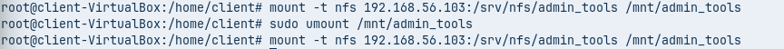


**---**

Un cop desmuntat i tornat a muntar el recurs, crearem un fitxer nou com a root del client. Ara el fitxer hauria d'aparèixer com a propietat de `root` al servidor, perquè `no_root_squash` evita la conversió de l'UID 0 del client. Aquesta opció no fa que els dos sistemes siguin la mateixa màquina: simplement conserva la identitat root en les peticions NFS.


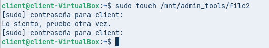


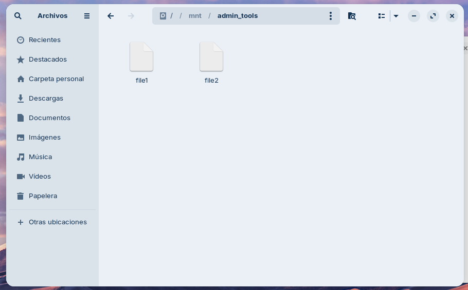


Si la prova funciona, confirma que `no_root_squash` està aplicat. Per verificar-ho al servidor, podem consultar el propietari del fitxer amb `ls -l /srv/nfs/admin_tools`. Després d'editar `/etc/exports`, cal aplicar els canvis amb `sudo exportfs -ra` o reiniciar el servei NFS.


**---**


# Fase 4


En aquesta fase, la xarxa `192.168.56.0/24` tindrà accés de lectura i escriptura a `dev_projects`, mentre que el client amb IP `192.168.56.100` només hi tindrà accés de lectura. Cal que la IP del client sigui exactament la que correspon a cada prova.


**---**

Per poder fer això haurem de modificar l'arxiu /etc/exports i substituir la linia "/srv/nfs/dev_projects *(rw,sync,no_subtree_check)" per les seguents:


```bash

/srv/nfs/dev_projects 192.168.56.0/24(rw,sync,no_subtree_check)

/srv/nfs/dev_projects 192.168.56.100(ro,sync,no_subtree_check)

```

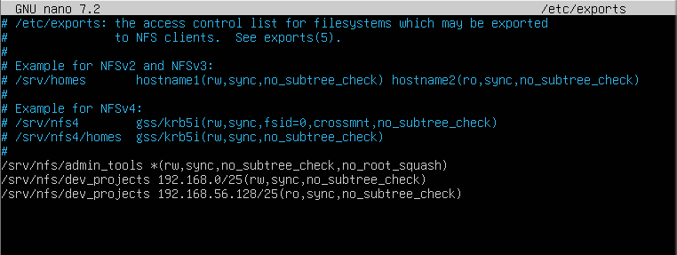


Aquestes línies defineixen els permisos segons la IP d'origen del client. La regla de l'adreça concreta `192.168.56.100` és més específica que la regla de la subxarxa. Després de modificar `/etc/exports`, aplicarem els canvis amb `sudo exportfs -ra`.


**---**

Un cop fet, reinciem el servei.


```bash

systemctl restart nfs-kernel-server

```


**---**

Ara hem de montar el disc dev_projects per comprobar que tot funciona correctament. Primer hem de crear la carpeta.


```bash

mkdir /mnt/dev_projects

```


**---**

Primer provarem amb una IP de la subxarxa `192.168.56.0/24` diferent de `192.168.56.100` per comprovar que la xarxa té lectura i escriptura. Després canviarem la IP del client a `192.168.56.100`, desmuntarem i tornarem a muntar el recurs per comprovar que només permet llegir. La IP ha d'estar lliure i dins de la xarxa Host-only configurada.


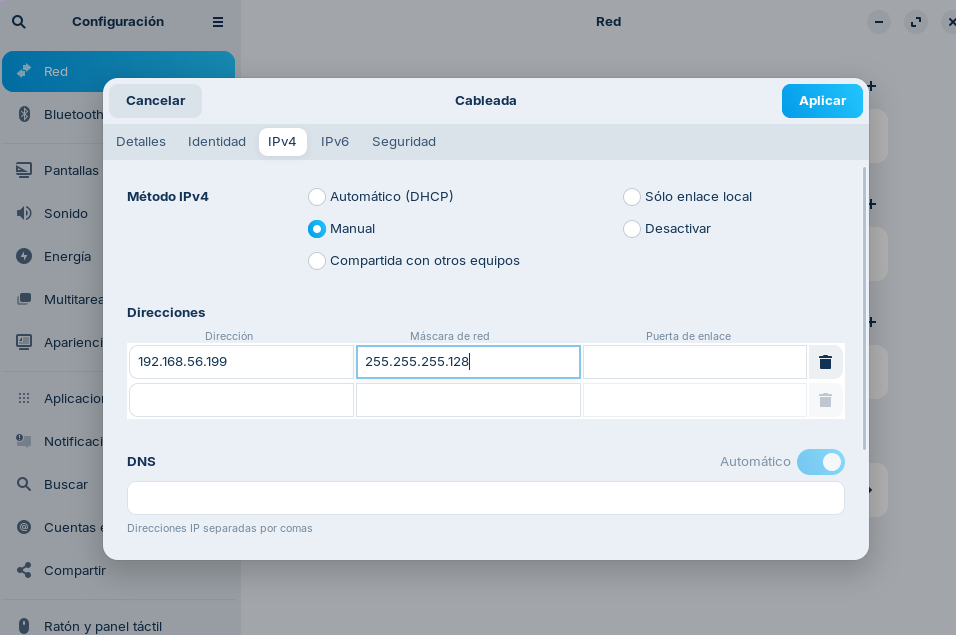


**---**


Per ultim hem de fer login amb l'usuari dev01 i probem a crear un arxiu en la carpeta dev_projects


Amb la IP `192.168.56.100`, `dev01` no hauria de poder crear ni modificar fitxers perquè l'exportació és de només lectura (`ro`). Després, tornarem a una IP autoritzada per escriptura i provarem amb `admin01`: tampoc no hauria de poder escriure, perquè el directori és `root:devs` amb permisos `770` i `admin01` no pertany al grup `devs`. Això permet distingir els permisos de xarxa NFS dels permisos locals del sistema de fitxers.


**---**

# Fase 5

**---**

Ara modificarem `/etc/fstab` al client perquè els recursos NFS es muntin automàticament durant l'inici del sistema.

**---**

Per començar hem d'entrar al arxiu.


```bash

sudo nano /etc/fstab

```


Abans, comprovarem que existeixen els punts de muntatge amb `sudo mkdir -p /mnt/admin_tools /mnt/dev_projects`. Afegirem aquestes dues línies al final de `/etc/fstab`, substituint `192.168.56.103` per la IP Host-only real del servidor si és diferent.


```bash

192.168.56.103:/srv/nfs/admin_tools /mnt/admin_tools nfs defaults 0 0

192.168.56.103:/srv/nfs/dev_projects /mnt/dev_projects nfs defaults 0 0

```

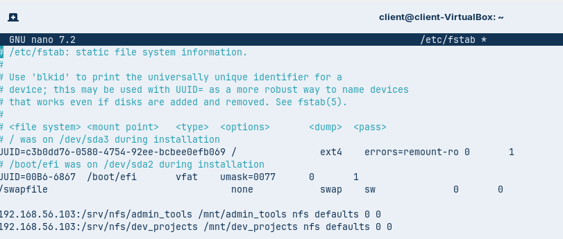


**---**

Abans de reiniciar, executarem `sudo mount -a` per comprovar que no hi ha errors a `/etc/fstab`. Si no mostra cap error, podem reiniciar el client i verificar els muntatges amb `findmnt -t nfs` o `mount | grep nfs`.


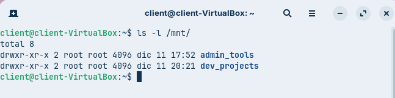


**---**


# Conclusió


En general, la creació del servidor NFS és una eina potent i útil, però la manera com l'hem utilitzat presenta algunes limitacions importants. Un dels principals inconvenients és haver de crear els usuaris i grups tant al servidor com a cada màquina client, això fa repetir els mateixos passos moltes vegades i generar una càrrega de feina innecessària.


Per evitar aquesta feina repetitiva, es podria centralitzar l'autenticació i la gestió d'usuaris amb LDAP o una solució similar. També és important que els UID i GID coincideixin entre servidor i client, ja que NFS utilitza aquests identificadors per aplicar els permisos. En conclusió, ha estat una pràctica llarga perquè hem hagut de configurar i comprovar diverses vegades els usuaris, els grups, les exportacions i els permisos. Les proves han servit per entendre la diferència entre `root_squash` i `no_root_squash`, així com entre els permisos d'accés NFS (`rw`/`ro`) i els permisos locals del sistema de fitxers.


- [Tornar a l’enunciat](readme.md)
